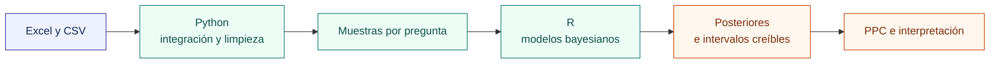

  <h1>Delitos bajo incertidumbre</h1>
  
<strong>Preparación de datos en Python e inferencia bayesiana en R</strong> 
  De archivos heterogéneos a probabilidades posteriores, intervalos creíbles y decisiones interpretables.

  

    
    
    
    
    
    
    
    
  

  
<a href="analysis/Proyecto_bayesiana_delitos.Rmd">Ver el análisis</a> · <a href="report/Proyecto_bayesiana_delitos.pdf">Leer el informe histórico</a> · <a href="#evidencia">Seguir la evidencia</a>

  
<a href="#resumen">Resumen</a> · <a href="#ruta">Ruta</a> · <a href="#preguntas">Modelos</a> · <a href="#resultados">Resultados</a> · <a href="#trabajo">Mi trabajo</a> · <a href="#evidencia">Evidencia</a> · <a href="#detalles">Alcance</a>

**Autor:** [Fabián Tovar](https://github.com/fabiantovarc) · **Informe histórico:** mayo de 2025

## En 30 segundos

<table align="center">
  <tr>
    <td align="center"><strong>419.907</strong> registros de Bogotá</td>
    <td align="center"><strong>214.299</strong> filas de Cali</td>
    <td align="center"><strong>≈1,87 millones</strong> filas en preparación</td>
    <td align="center"><strong>3</strong> familias bayesianas</td>
  </tr>
</table>

> **🎯 Aporte central:** convertir preguntas sobre registros delictivos en distribuciones de incertidumbre, en lugar de reducir el análisis a una predicción puntual.

Este proyecto integra limpieza de datos en Python con inferencia en R para estudiar proporciones, composición etaria y tendencias temporales en registros de Bogotá y Cali. Los modelos trabajan con muestras de **400 registros o eventos**, según la pregunta; la cifra de preparación no es el tamaño de las muestras modeladas.

## De la fuente a la inferencia

La preparación unifica esquemas, normaliza texto y fechas, trata faltantes y construye categorías. R utiliza esas salidas para actualizar priors, simular y evaluar modelos conjugados y de regresión.

## Preguntas y modelos

| Pregunta | Modelo | Evidencia que se comunica |
|---|---|---|
| ¿La proporción registrada sin armas supera el 50 %? | Beta–Binomial | Probabilidad posterior e intervalo HPD |
| ¿La proporción del grupo adulto supera el 65 %? | Dirichlet–Multinomial | Marginal Beta, probabilidad e intervalo creíble |
| ¿Cómo cambia el conteo anual esperado? | Poisson bayesiano con enlace log | Posterior de la pendiente, razón temporal y chequeos predictivos |

Los ajustes `brms` utilizan **4 cadenas**, **4.000 iteraciones por cadena** y semilla 123. La fuente también conserva implementaciones manuales de Metropolis-within-Gibbs y simulación Dirichlet para hacer explícitos los mecanismos de inferencia.

## Resultados que sí permite afirmar

| Análisis | Resultado posterior conservado | Lectura |
|---|---:|---|
| Registros sin armas | `P(θ > 0,5) = 11,95 %`; HPD 95 % **[42,27 %; 51,92 %]** | No alcanza el criterio definido para afirmar una proporción superior al 50 %. |
| Grupo etario adulto | `P(θ > 0,65) = 82,62 %`; intervalo 95 % **[62,83 %; 70,92 %]** | Favorece superar el umbral, aunque el intervalo incluye el 65 %. |
| Tendencia de Cali | `P(β > 0) = 75,55 %`; razón 2019/2010 **[0,818; 1,510]** | Señal creciente bajo el modelo, sin evidencia concluyente según el criterio establecido. |
| Diferencia de pendientes | `P(βBogotá > βCali)` cercana a 1; intervalo **[0,2773; 0,3621]** | Bogotá presenta una pendiente mayor en las muestras y modelos analizados. |

> **⚠️ Alcance:** estas cifras provienen de salidas históricas del informe. No se presentan como predicción fuera de muestra, tasas por habitante, evidencia causal ni demostración de cobertura uniforme.

Los **posterior predictive checks** de Bogotá también muestran discrepancias en los extremos. Ese resultado orienta mejoras como sobredispersión o cambios de nivel, y recuerda que una posterior estrecha no valida por sí sola un modelo.

## Mi trabajo en este proyecto

- Integré archivos Excel y CSV con esquemas heterogéneos y preparé categorías comparables por ciudad.
- Diseñé preguntas probabilísticas y traduje cada una a un modelo bayesiano adecuado.
- Implementé actualizaciones conjugadas, simulación manual y ajustes `brms`/Stan con una configuración reproducible dentro del informe histórico.
- Interpreté probabilidades posteriores, intervalos creíbles y chequeos predictivos sin convertirlos en afirmaciones causales.

### Competencias demostradas

| Competencia | Evidencia |
|---|---|
| Preparación de datos | Normalización de esquemas, categorías, fechas y faltantes en Python |
| Inferencia bayesiana | Beta–Binomial, Dirichlet–Multinomial y Poisson con enlace log |
| Computación estadística | `brms`/Stan y algoritmos manuales para comprender la inferencia |
| Criterio de modelado | Posterior predictive checks y lectura de discrepancias |
| Comunicación | R Markdown, informe PDF, tablas y conclusiones con alcance explícito |

## Evidencia y archivos

| Evidencia | Qué revisar |
|---|---|
| [Fuente del análisis](analysis/Proyecto_bayesiana_delitos.Rmd) | Código R, fórmulas, priors, simulaciones y modelos |
| [Informe histórico](report/Proyecto_bayesiana_delitos.pdf) | Resultados y visualizaciones conservados; proporción sin armas, pp. 8–12; grupo adulto, pp. 17–21; Cali, pp. 34–35; comparación, p. 39 |
| [Limpieza de registros](preprocessing/delitos_limpieza.ipynb) | Normalización y revisión de calidad de datos |
| [Preparación de Cali](preprocessing/proyecto.ipynb) | Tratamiento de variables y exportación de la base de Cali |

### Tecnologías

**Python:** pandas, NumPy, Matplotlib, `re`, `unicodedata`, `glob`, `os` · **R:** dplyr, tidyr, lubridate, ggplot2, gridExtra · **Inferencia:** brms, Stan, modelos conjugados y simulación · **Documentación:** Jupyter, R Markdown, knitr y XeLaTeX.

## Alcance y reproducibilidad

<strong>Estado histórico, unidades y entorno</strong>

Esta edición es documental: no se ejecutaron notebooks, R ni modelos para esta publicación. El PDF corresponde al informe de mayo de 2025 y la fuente R Markdown conserva bloques de trabajo que no aparecen en ese PDF. Las cifras de resultados son las salidas históricas citadas arriba. La copia R Markdown conserva el discurso revisado, sin modificar bloques de código ni expresiones R.

La preparación guardada muestra **1.873.996 filas**. La entrada histórica de Bogotá corresponde a **419.907 registros de 2010–2019**; el notebook de limpieza conservado exporta después otra variante de hurtos/abigeato de 2011–2018, por lo que no se presenta como reconstrucción exacta. En Cali, **214.299 filas representan 215.104 eventos** al considerar `CANTIDAD`; las unidades no son intercambiables. No se incluyen los CSV ni los Excel originales y no hay un entorno de dependencias bloqueado. Reproducir el análisis requiere recuperar las fuentes históricas, ajustar rutas y revisar versiones.

<strong>Procedencia y semántica</strong>

Los archivos se atribuyen al portal de [estadística delictiva de la Policía Nacional de Colombia](https://www.policia.gov.co/estadistica-delictiva) y al [portal de datos abiertos de Santiago de Cali](https://datos.cali.gov.co). Los enlaces identifican los portales citados, no garantizan la disponibilidad de las mismas versiones históricas.

Las categorías describen registros del dataset. El grupo etario no se interpreta automáticamente como edad del perpetrador. “Sin empleo de armas” es la categoría literal usada en el análisis; su complemento agrupa otras categorías, incluidos registros sin reporte, por lo que no se interpreta como confirmación individual de uso de armas.

## Créditos y procedencia

Proyecto académico de estadística bayesiana. Autor: **Fabián Tovar**. Los datos originales no se redistribuyen en este repositorio.
