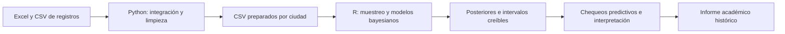

# Delitos bajo incertidumbre

### Preparación de datos en Python e inferencia bayesiana en R

**De archivos heterogéneos a preguntas estadísticas, distribuciones posteriores y límites de interpretación.**

Este proyecto académico analiza registros delictivos de Bogotá y Cali mediante modelos Beta–Binomial, Dirichlet–Multinomial y regresión Poisson bayesiana. Integra preparación de datos en Python, modelado en R y comunicación de resultados con intervalos creíbles y chequeos predictivos posteriores.

**Autor:** [Fabián Tovar — Edisson Fabian Tovar Castro](https://github.com/fabiantovarc) · **Informe histórico:** mayo de 2025.

[Resumen](#el-proyecto-en-30-segundos) · [Proceso](#de-la-fuente-a-la-inferencia) · [Resultados](#resultados-del-informe) · [Competencias](#qué-demuestra-este-proyecto) · [Archivos](#recorrido-por-el-repositorio)

---

## El proyecto en 30 segundos

| Dimensión | Evidencia |
|---|---|
| Problema | Cuantificar incertidumbre sobre uso de armas, grupos etarios y tendencias temporales de registros delictivos. |
| Preparación | Integración de Excel, normalización de texto, tratamiento de faltantes, fechas y agrupación de categorías. |
| Bases utilizadas por R | Bogotá: **419.907 registros**, 7 variables. Cali: **214.299 registros**, 17 variables. |
| Modelado | Muestras de **400 registros o eventos**, según la sección; no se ajustaron los modelos con todas las filas. |
| Inferencia | Priors explícitas, actualización conjugada, simulación y regresión bayesiana con **brms / Stan**. |
| Evaluación | Intervalos creíbles y chequeos predictivos que también identifican limitaciones del modelo. |

> **El aporte central:** formular preguntas probabilísticas y explicar qué permiten concluir los datos, no limitarse a producir una predicción puntual.

## De la fuente a la inferencia

El diagrama representa el proceso realizado. Los notebooks conservan versiones de trabajo: su ejecución actual no constituye por sí sola una reconstrucción exacta de todos los insumos del informe. La sección de reproducibilidad explica esas diferencias.

### 1. Preparación con Python

- **Integración:** lectura recursiva de archivos Excel, selección de columnas comunes y creación de la categoría delictiva desde el nombre del archivo.
- **Normalización:** minúsculas/mayúsculas, eliminación de tildes y variantes en municipios, delitos y categorías de no reporte.
- **Calidad de datos:** revisión de tipos, frecuencias y faltantes; tratamiento de valores anómalos en medios empleados.
- **Variables temporales:** conversión de fechas y extracción de horas.
- **Cali:** agrupación de sitios, profesiones, clases de empleo, nacionalidades, edades y armas; exportación del conjunto preparado.

La salida guardada de la base unificada muestra **1.873.996 filas**. Esa cifra corresponde a la preparación multiciudad: no es el tamaño de la muestra de inferencia ni exclusivamente el de Bogotá.

### 2. Modelos con R

| Pregunta | Modelo | Especificación implementada |
|---|---|---|
| ¿La proporción registrada sin armas supera el 50 %? | Beta–Binomial | Prior Beta(2,85; 6,65), definida mediante media y varianza; actualización conjugada y simulación Random Walk Metropolis. |
| ¿La proporción del grupo adulto supera el 65 %? | Dirichlet–Multinomial | Prior informativa, conteos por grupo etario y marginal Beta para calcular probabilidades e intervalos. |
| ¿Cómo cambia el conteo anual esperado? | Poisson con enlace log | Modelos independientes para Bogotá y Cali: `log(lambda_t) = alpha + beta * (year - 2010)`. Priors normales y ajuste con brms / Stan. |

Los ajustes `brms` especifican **4 cadenas y 4.000 iteraciones por cadena**, con semilla 123. La fuente también contiene implementaciones manuales de Metropolis-within-Gibbs y simulación directa Dirichlet, como evidencia del trabajo con los mecanismos de inferencia.

## Resultados del informe

Las siguientes cifras provienen de las salidas históricas del PDF; no se recalcularon para esta publicación.

| Análisis | Resultado guardado | Interpretación |
|---|---|---|
| Registros sin armas | `P(theta > 0,5) = 11,95 %`; HPD 95 % **[42,27 %; 51,92 %]**. | No alcanza el criterio de evidencia fuerte para afirmar una proporción superior al 50 %. |
| Grupo etario adulto | `P(theta > 0,65) = 82,62 %`; intervalo creíble 95 % **[62,83 %; 70,92 %]**. | Favorece superar el umbral, pero el intervalo incluye el 65 % y la probabilidad no llega al criterio del 95 %. |
| Tendencia de Cali | `P(beta > 0) = 75,55 %`; razón 2019/2010 con intervalo 95 % **[0,818; 1,510]**. | Estimación central levemente creciente, sin evidencia concluyente bajo el criterio establecido. |
| Diferencia de pendientes | `P(beta_Bogota > beta_Cali)` cercana a 1; intervalo 95 % **[0,2773; 0,3621]**. | En los modelos y muestras analizados, la pendiente de Bogotá es mayor. No equivale a comparar riesgos por habitante. |

Referencias dentro del informe: proporción sin armas, pp. 8–12; grupo adulto, pp. 17–21; Cali, pp. 34–35; comparación, p. 39.

### Evaluar también lo que el modelo no explica

Los **posterior predictive checks** de Bogotá contrastan observaciones con simulaciones del modelo. El informe reconoce discrepancias en los extremos y plantea explorar sobredispersión o cambios de nivel. Esa revisión es parte del resultado: un ajuste no queda validado únicamente por producir una posterior estrecha.

No se presentan estos resultados como predicción fuera de muestra, evidencia causal, tasas por habitante ni demostración de cobertura uniforme de los registros.

## Qué demuestra este proyecto

| Competencia | Evidencia concreta |
|---|---|
| Preparación de datos heterogéneos | Integración de Excel y CSV con normalización de esquemas y categorías. |
| Fundamentos estadísticos | Formulación de verosimilitudes, priors y actualizaciones posteriores conjugadas. |
| Computación bayesiana | Uso de brms / Stan y código de simulación manual para comprender la inferencia. |
| Interpretación de incertidumbre | Probabilidades posteriores, intervalos creíbles y comparación de cantidades derivadas. |
| Criterio de modelado | Chequeos predictivos y reconocimiento de discrepancias del modelo Poisson. |
| Comunicación técnica | Código R Markdown e informe que conectan preguntas, supuestos, resultados e interpretación. |

### Tecnologías utilizadas

- **Python:** pandas, NumPy, Matplotlib; `re`, `unicodedata`, `glob` y `os` para preparación e integración.
- **R:** dplyr, tidyr, lubridate, ggplot2, gridExtra y funciones estadísticas de R.
- **Inferencia:** brms / Stan, modelos conjugados y algoritmos de simulación explícitos.
- **Documentación:** Jupyter Notebook, R Markdown / knitr y salida PDF con XeLaTeX.

## Recorrido por el repositorio

| Archivo | Qué revisar |
|---|---|
| [Fuente del análisis](analysis/Proyecto_bayesiana_delitos.Rmd) | Modelos, fórmulas, código y discurso precisado para portafolio. |
| [Informe académico histórico](report/Proyecto_bayesiana_delitos.pdf) | Salidas y visualizaciones conservadas de mayo de 2025. |
| [Limpieza de registros](preprocessing/delitos_limpieza.ipynb) | Normalización y revisión de calidad; su exportación final es una variante de hurtos 2011–2018. |
| [Preparación de Cali](preprocessing/proyecto.ipynb) | Tratamiento de variables y exportación de la base de Cali. |

## Alcance y reproducibilidad

<strong>Versiones, unidades de análisis y ejecución</strong>

**Esta edición es documental.** No se ejecutaron notebooks, R ni modelos. Los notebooks y el PDF se conservan byte a byte; en la copia R Markdown se precisó el discurso, sin modificar bloques de código ni expresiones R. Por ello, algunos comentarios históricos del código conservan terminología aclarada en el texto.

**PDF histórico, no recompilación actual.** La fuente Rmd contiene bloques de simulación que no aparecen en el PDF de mayo de 2025. El PDF conserva sus resultados y redacción originales; las precisiones de esta edición se encuentran en el README y en la copia Rmd.

**Versiones de Bogotá.** Se verificó que el CSV de Bogotá usado por R contiene 419.907 registros entre 2010 y 2019, y que coincide byte a byte con su copia en la carpeta Python. Sin embargo, el notebook de limpieza actualmente conservado termina exportando otra variante: hurtos/abigeato de 2011–2018. No se presenta como reconstrucción exacta del insumo histórico.

**Registros no siempre equivalen a eventos.** Bogotá suma `CANTIDAD` dentro de la muestra; Cali cuenta filas después de eliminar esa columna. El CSV original de Cali contiene 214.299 registros y 215.104 eventos, con 697 registros de cantidad mayor que uno. La comparación describe las unidades implementadas y no demuestra equivalencia completa de cobertura entre fuentes.

**Datos y entorno.** No se incluyen los CSV ni los archivos Excel originales. Las fuentes conservan rutas locales históricas y no se agregó un entorno bloqueado de dependencias. Para reproducir el estudio habría que recuperar y verificar las versiones de los datos, ajustar rutas y revisar el entorno; este repositorio no afirma ejecución directa ni reproducción validada.

**Semántica de categorías.** Se habla del grupo etario registrado, sin atribuir automáticamente esa edad al perpetrador. En el primer modelo, la categoría complementaria a «sin empleo de armas» incluye otras categorías, entre ellas registros sin reporte; no se interpreta como confirmación individual de uso de armas.

### Procedencia de los datos

El material del proyecto atribuye los archivos de Bogotá al portal de [estadística delictiva de la Policía Nacional de Colombia](https://www.policia.gov.co/estadistica-delictiva) y los de Cali al [portal de datos abiertos de Santiago de Cali](https://datos.cali.gov.co). Estos enlaces identifican los portales citados en el trabajo, no una garantía de disponibilidad de las versiones históricas exactas. Los datos originales no se redistribuyen aquí.

---

**Un proyecto para mostrar el proceso completo:** preparar datos, explicitar supuestos, inferir con incertidumbre y comunicar resultados sin ocultar sus límites.
